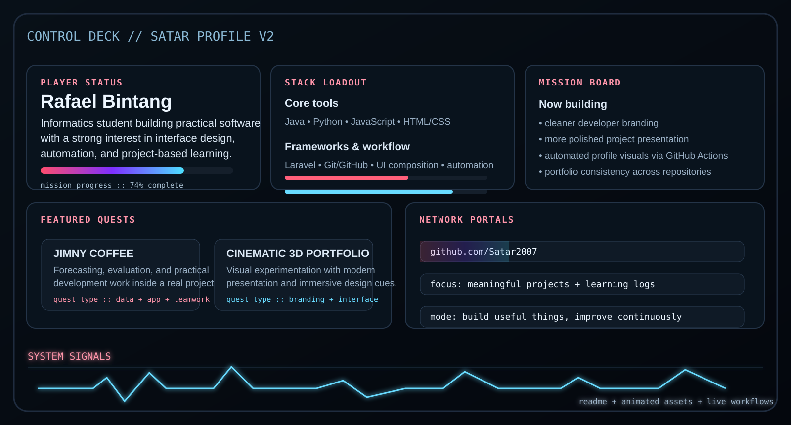
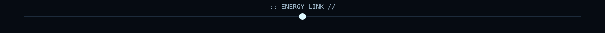
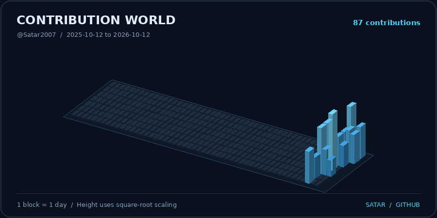
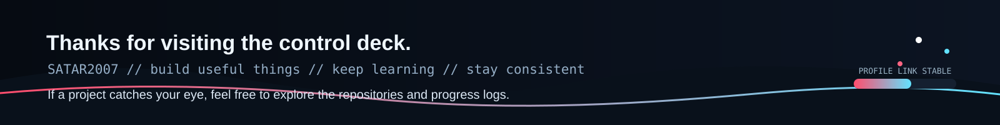

<div align="center">
  
</div>

<div align="center">
  
  
  
</div>

<div align="center">
  
</div>

<div align="center">
  
</div>

## 🎮 Player Profile

```txt
> username      : Satar2007
> identity      : Rafael Bintang
> role          : Informatics Student • Creative Developer
> main mission  : Build useful software, improve consistently, and present work clearly.
> current mode  : Full Futuristic Gaming Profile V2
```

## 🧰 Loadout

<div align="center">

| Category | Equipped |
|---|---|
| Languages | Java, Python, JavaScript, HTML, CSS |
| Tools & Workflow | Git, GitHub Actions, UI composition, repository organization |
| Interests | Software projects, automation, design presentation, learning by building |
| Vibe | Futuristic dashboard, arcade energy, cinematic profile presentation |

</div>

## 🚀 Featured Quests

<div align="center">
  <a href="https://github.com/Satar2007/Proyek-Informatika">JIMNY COFFEE repository ↗</a>
  &nbsp; • &nbsp;
  <a href="https://github.com/Satar2007/cinematic-3d-portfolio-template">Cinematic 3D Portfolio repository ↗</a>
</div>

- **JIMNY COFFEE** — practical development work, forecasting flow, evaluation, and collaboration.
- **Cinematic 3D Portfolio** — visual exploration for immersive interface and presentation ideas.

<div align="center">
  
</div>

## 📡 Live Telemetry

### GitHub Metrics
<p align="center">
  
</p>

### Isometric Calendar
<p align="center">
  
</p>

### Contribution Skyline
<p align="center">
  
</p>

## 👾 Contribution Arcade

<picture>
  <source media="(prefers-color-scheme: dark)" srcset="assets/generated/pacman-contribution-graph-dark.svg" />
  <source media="(prefers-color-scheme: light)" srcset="assets/generated/pacman-contribution-graph.svg" />
  
</picture>

<div align="center">
  <sub>Pac-Man graphic powered by <a href="https://github.com/abozanona/pacman-contribution-graph">abozanona/pacman-contribution-graph</a></sub>
</div>

<div align="center">
  
</div>

## 🌐 Network Portals

<div align="center">
  <a href="https://github.com/Satar2007?tab=repositories">Repositories</a>
  &nbsp; • &nbsp;
  <a href="https://github.com/Satar2007?tab=stars">Stars</a>
  &nbsp; • &nbsp;
  <a href="https://github.com/Satar2007?tab=projects">Projects</a>
</div>

<div align="center">
  
</div>
